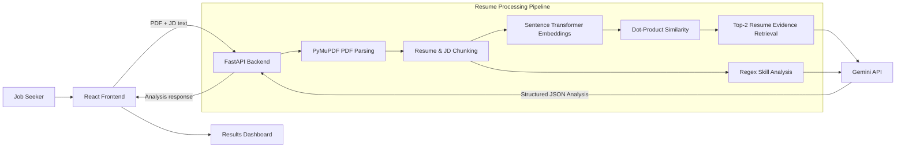

# ResuMatch AI

**Semantic resume and job-description matching for clearer skill-gap insights.**


## Overview

ResuMatch AI helps job seekers compare a PDF resume with a target job description. It extracts resume text, identifies overlapping and missing skills, retrieves the resume sections most relevant to each requirement, and generates an improvement-focused AI assessment.

The application is implemented as a React frontend and a FastAPI backend. It does not use a database or retain uploaded resume data beyond processing the analysis request.

## Key Features

- PDF resume upload with drag-and-drop or file selection
- PDF validation and text extraction from searchable PDFs
- Target job-description text input
- Deterministic skill extraction for a predefined skill catalog
- Semantic matching with sentence-transformer embeddings
- Retrieval of the two most relevant resume chunks for each JD requirement
- Gemini-generated overall match score, strengths, missing skills, and improvement suggestions
- Responsive results dashboard with score visualization and expandable evidence
- Frontend validation and backend error handling

## How It Works

1. The user uploads a searchable PDF resume and enters a job description.
2. The React frontend sends a multipart request to the FastAPI `/analyze` endpoint.
3. PyMuPDF extracts text from the PDF.
4. Resume and JD text are divided into structured chunks.
5. Sentence Transformers creates normalized embeddings with `all-MiniLM-L6-v2`.
6. Dot-product similarity identifies the top two resume chunks for every JD chunk.
7. Regex and alias-based analysis identifies matched and missing predefined skills.
8. Gemini receives the resume, JD, retrieval evidence, and skill report, then returns structured JSON.
9. The frontend renders the score, summary, skill coverage, evidence, suggestions, and recommendations.

## Tech Stack

| Area | Technologies |
|---|---|
| Frontend | React 19, Vite 8, Tailwind CSS 4, Axios, Lucide React |
| Backend | Python, FastAPI, Uvicorn |
| PDF Processing | PyMuPDF (`fitz`) |
| AI / Embeddings | Google Gemini API, Sentence Transformers, `all-MiniLM-L6-v2` |
| Similarity | NumPy dot-product similarity |
| Configuration | Python `python-dotenv`, Vite environment variables |

## Project Architecture



## Project Structure

```text
ResuMatch-AI/
├── Backend/
│   ├── .env
│   ├── app/
│   │   └── main.py                 # FastAPI application and API routes
│   └── services/
│       ├── chunking.py             # Resume section and JD chunking
│       ├── embeddings.py           # Sentence-transformer embeddings
│       ├── similarity.py           # Similarity and relevant-chunk retrieval
│       ├── skill_analysis.py       # Predefined skill extraction and gap analysis
│       ├── gemini_service.py       # Gemini prompt and JSON response handling
│       └── test_file.py
├── Frontend/
│   ├── .env.example
│   ├── package.json
│   ├── vite.config.js
│   └── src/
│       ├── App.jsx
│       ├── components/
│       │   ├── ResumeUploader.jsx
│       │   ├── JobDescriptionInput.jsx
│       │   ├── ResultsDashboard.jsx
│       │   ├── ScoreGauge.jsx
│       │   ├── SkillAnalysis.jsx
│       │   ├── EvidenceSection.jsx
│       │   ├── ImprovementSuggestions.jsx
│       │   └── Recommendations.jsx
│       └── services/
│           └── api.js
```

## Installation and Setup

### Prerequisites

- Windows 10 or 11
- Python 3.10 or later
- Node.js 18 or later
- npm
- A Google Gemini API key

### 1. Clone the repository

```powershell
git clone https://github.com/PavanBojja33/ResuMatch-AI.git
cd ResuMatch-AI
```

### 2. Set up the backend

```powershell
cd Backend
py -m venv .venv
.venv\Scripts\activate
python -m pip install --upgrade pip
python -m pip install fastapi uvicorn python-dotenv pymupdf numpy sentence-transformers google-genai python-multipart
```

Create `Backend/.env` if it does not already exist:

```dotenv
GEMINI_API_KEY=your_gemini_api_key
```

The code loads environment variables from the backend working directory. Start the backend from `Backend` as shown below.

### 3. Set up the frontend

Open a new PowerShell window:

```powershell
cd Frontend
npm install
Copy-Item .env.example .env
```

The default frontend configuration is:

```dotenv
VITE_API_BASE_URL=http://localhost:8000
```

## Environment Variables

| Location | Variable | Required | Purpose |
|---|---|---:|---|
| `Backend/.env` | `GEMINI_API_KEY` | Yes | Authenticates requests to Google Gemini |
| `Frontend/.env` | `VITE_API_BASE_URL` | No | FastAPI base URL; defaults to `http://localhost:8000` |

Never commit real API keys or credentials.

## Running the Application

### Start the backend

From `Backend`:

```powershell
.venv\Scripts\activate
python -m uvicorn app.main:app --reload --host 127.0.0.1 --port 8000
```

The API documentation is available at:

- Swagger UI: `http://127.0.0.1:8000/docs`
- ReDoc: `http://127.0.0.1:8000/redoc`

### Start the frontend

From `Frontend`:

```powershell
npm run dev
```

Open `http://localhost:5173` in your browser.

### Build the frontend

```powershell
npm run build
npm run preview
```

## API Endpoints

| Method | Path | Purpose |
|---|---|---|
| `GET` | `/` | Returns a basic welcome message |
| `POST` | `/upload-resume` | Validates a PDF and extracts searchable text from its pages |
| `POST` | `/process-jd` | Cleans pasted job-description text and returns the processed value |
| `POST` | `/analyze` | Performs the complete resume-versus-JD analysis pipeline |

### `/upload-resume`

Multipart form field:

- `resume`: PDF file

### `/process-jd`

JSON request body:

```json
"Paste the job description text here"
```

### `/analyze`

Multipart form fields:

- `file`: PDF resume
- `jd_text`: Job-description text

The frontend currently uses `/analyze`; `/upload-resume` and `/process-jd` are available backend routes but are not separately called by the React application.

## AI / RAG Workflow

The implemented pipeline includes practical RAG-style retrieval:

- **PDF parsing:** PyMuPDF extracts text and rejects files that are not PDFs or contain no readable text.
- **Chunking:** Resume text is grouped by detected section names; JD text is split into non-empty, bullet-cleaned lines.
- **Embeddings:** `all-MiniLM-L6-v2` generates normalized vectors for both resume and JD chunks.
- **Similarity and retrieval:** Dot-product similarity ranks resume chunks against JD chunks, returning the top two matches per requirement.
- **Skill analysis:** A predefined alias catalog identifies Java, Python, JavaScript, React, Node.js, SQL, Docker, AWS, and other supported skills.
- **LLM integration:** Gemini receives the source text, skill report, and retrieved evidence and returns strict JSON for the dashboard.

The project does not currently use a vector database or persistent document store. Similarity matrices are computed in memory for one request.

## Future Improvements

The following ideas are not implemented in the current codebase:

- Persistent resume history or user accounts
- Database-backed storage
- OCR support for scanned or image-only PDFs
- Larger or configurable skill catalogs
- Vector database and persistent RAG indexes
- Configurable chunk sizes and retrieval parameters
- Automated tests and CI workflows
- Deployment configuration
- Resume file download or PDF export
- Authentication and authorization

## Author

**Pavan Bojja**

- GitHub: [@PavanBojja33](https://github.com/PavanBojja33)
